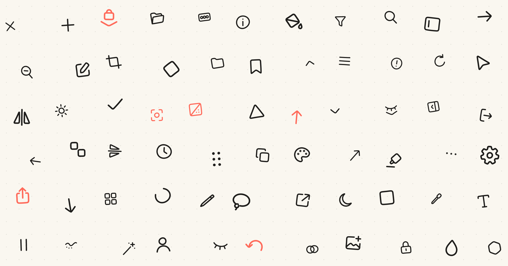
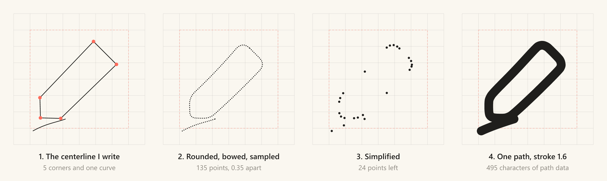
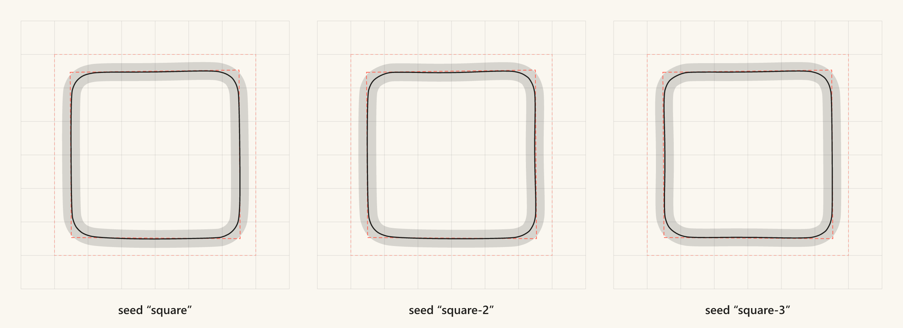
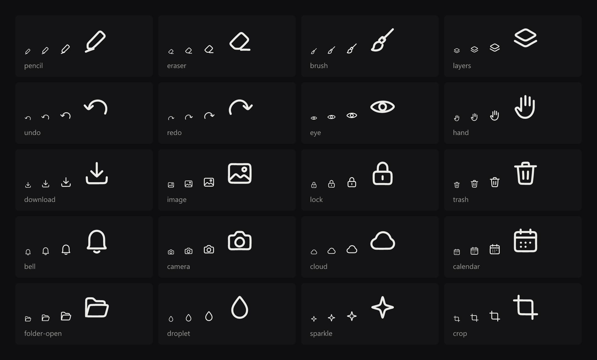
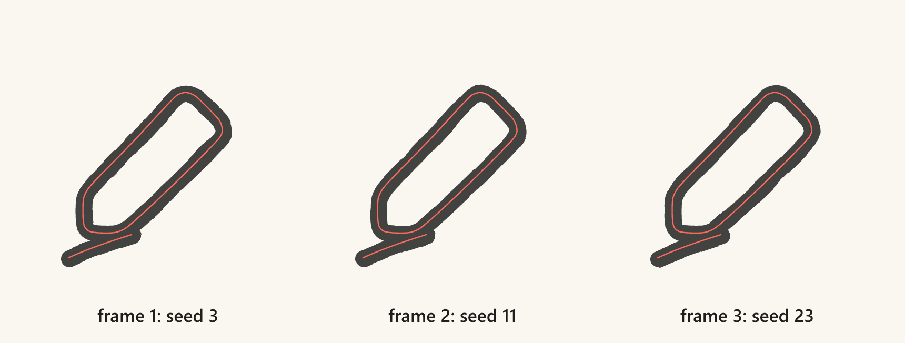

I built Zketch for doodling, and doodles don't follow straight lines. Yet every button around its canvas was drawn with a ruler: dead-straight edges, compass-perfect arcs, corners that meet at exact angles. Replacing them took me from a pile of uneven sketches to 143 brush-drawn icons whose small imperfections are the whole point, and then to zicons, a set anyone can use.



## A doodle app with ruler-straight buttons

Zketch is a drawing app that runs in the browser. You open it, pick a brush and scribble. For a long time, the buttons around that scribbling came from Lucide, a popular open-source icon set, plus a few extra SVGs I added in the same style so they'd match. The undo arrow, for example, used the path from Feather, the set Lucide grew out of: a perfect arc with a radius of exactly 9, ending in an arrowhead bent at a right angle. Everything matched, and that was the problem.

There's nothing wrong with Lucide or Feather. They're made for precise, neutral interfaces, and they're very good at that. But Zketch isn't a neutral interface. It exists for loose, wobbly lines. Everything on the canvas said "draw freely," and everything around it said "measure twice." The icons didn't carry the feel of the reason I was making the app. Put side by side with what replaced them, the difference is small but it's everywhere:

 and zicons (bottom), shown larger than in the app: the same tools, with softer corners and lines that aren't quite straight.")

## Drawing them by hand, and why it didn't work

The obvious fix was to draw new ones myself, and I had the right tool for it. I sketched icons in Zketch, with its own brushes.

They had plenty of character, and not one came out the same size as the next. Charming on paper. Less charming as a button you're trying to click.

An icon set has a job that a sketch doesn't. Every icon has to sit on the same grid, carry the same weight, and stay readable at 14 pixels as well as at 56. Drawn freehand, each icon was a one-off, and a toolbar of one-offs looks messy rather than playful. None of those files are left, but the lesson stayed: I wanted my pen's feel without my hand's inconsistency.

## Imperfect on purpose

Things drawn by hand aren't perfect, and that's exactly why they feel human. A line drawn without a ruler drifts a little. A circle never quite closes the way a compass would. Corners come out soft because a pen can't make a sharp one. Those were the qualities I wanted, so the question became: how do you keep the imperfections and drop the mess?

My answer was to decide in advance exactly where the imperfection is allowed to live, and to make everything else strict. The strict part became a short set of rules:

- Every icon is drawn on a 24 by 24 grid and stays roughly inside the middle 18 by 18.
- One even line, 1.6 units wide, with round ends and round joins. No fills.
- Rounded corners everywhere. Nothing ends in a sharp point.
- Few strokes, and each stroke is a single pen movement. Most icons need two or three.

The imperfect part is small. Straight edges bow very slightly, and circles are a little out of round. That's all. But a bow that small, repeated across a whole toolbar, is enough to make the set feel drawn rather than built.

## Teaching code to hold the pen

I already had a drawing pipeline in Zketch, and I needed the feel of my brush on these icons. So I split the work in two. I describe each icon as a few pen movements, and code does the actual drawing, the same way every time.

The description is a centerline: the path the middle of the pen travels, before any line width is added. For the pencil icon it's two strokes, a body with five rounded corners and the little line underneath:

```js title="packages/icons/defs/core.mjs"
pencil: {
  strokes: [
    poly([[14.6, 5.1], [18.8, 9.3], [8.6, 19.2], [4.9, 19.1], [4.8, 15.4]], [1.8, 1.8, 1.3, 1.1, 1.3]),
    path("M3.5 21.5c2.5-1.4 4.4-1.6 6-2.2"),
  ],
},
```

The first list is where the corners go, and the second is how round each corner is. From there, a small generator takes over. It rounds the corners, bends the straight edges, walks along the result dropping a point roughly every third of a unit, and then thins those points down to the few that actually shape the line. Zketch uses the same trick to keep drawn strokes small. What comes out is one SVG path per icon, whatever the icon looks like. You can follow the pencil through it, left to right:



### A wobble that never changes

The bow on each straight edge is random, and that's a problem. Randomness in an icon set means a different icon on every build: the undo arrow you shipped yesterday quietly changes shape today.

So the randomness is borrowed from the icon's name. The generator turns the name into a number with a tiny hash function and uses that number as the seed for its random choices:

```js title="packages/icons/lib/catalog.mjs"
const d = sampleIcon(mod[name], hash(name)).map(toPathData).join("");
```

Every icon wobbles in its own way, and each one wobbles the same way forever. Here's the same square drawn with three different names. The inner red dashes are the straight square it started from (the outer ones mark the area every drawing stays inside), and the black line is where the pen went:



> [!IMPORTANT]
> Seed the randomness from the icon's name, and a wobbly line becomes as reproducible as a straight one.

## Goodbye, Lucide

With the generator doing the drawing, my job changed. I was no longer fighting my own hand to make two icons the same size. I was deciding what each icon should say in two or three pen movements, and the code made sure every one of them said it in the same voice.

I worked outward from the canvas: first the tools Zketch uses most, then the rest of the app, then everyday icons and art tools for whatever comes next. Each new icon went onto a contact sheet beside all the others, at several sizes, because an icon that looks lovely at 56 pixels can turn to mush at 14. On one sheet, an icon that doesn't belong is easy to spot:



Once the sheet looked like one set, I swapped them in. Every screen in Zketch moved to the brush-drawn icons, and Lucide came out of the project. The buttons around the canvas finally looked like they belonged to the drawing inside it. Zketch's project notes now carry a one-line rule: no Lucide.

## Letting the lines breathe

The bow made the icons look drawn. I also wanted them to feel alive.

In old hand-drawn cartoons, every frame was traced again by hand, so the lines shimmer slightly even when nothing moves. Animators call it line boil. zicons fakes it with two SVG filters: one makes a field of noise, and the other nudges each part of the icon's line by the amount the noise says. The noise cycles through three patterns in a 0.36-second loop, so a new one arrives every 0.12 seconds:

```js title="packages/icons/runtime/render.js"
export const SEEDS = [3, 11, 23];
export const BOIL_RATE = 0.36;
```

That's about eight new frames a second, which reads as a traced cartoon rather than smooth motion. The drawing itself never changes; only the noise over it does. Here are the three frames, with the real line in red on top:



The hard part was size. A shimmer that looks lively on a big icon makes a small one unreadable, so icons under 32 pixels get a gentler boil than larger ones, and within each group the wobble is scaled so it looks the same on screen at any size. You can have it on all the time, or only when someone hovers the icon or the button it sits in.

In your own project, the boil is off until you ask for it, one icon at a time, so whether it runs, and whether it follows reduced-motion settings, is your call. On the zicons site it's on for everyone, because the boil is how these icons show what they can do. If it's too much, a switch at the top of the page stops it.

## From Zketch's toolbar to everyone's

For a while the icons lived only inside Zketch. But I kept thinking about other people who want what I wanted: something fun, a little unusual, with a taste of its own instead of the same neat icons as every other app. So I gave the drawings their own project and called it zicons.

zicons is now where new icons get drawn. One file holds every icon with its name, group, search words and path, and everything else is generated from it: the website, plain SVG files, a sprite, and a component package for each of the big frameworks. Importing one icon adds about 3 KB to a bundle, not all 143.

## The future of zicons

The 143 icons cover a drawing app and the everyday basics. That's a start, not a finish. I don't have a target number in mind. What I want is a place where all your icon needs get covered, so you never have to mix in a ruler-straight icon from somewhere else because zicons didn't have one.

Here's what's planned:

- **A Figma file**, so designers can use the icons where they design, not only where they build.
- **Contributions and icon requests.** Right now every icon is coordinates I type into a file. I'd like a way for you to ask for the icon you're missing, and eventually to draw one yourself that follows the same rules.
- **More icons**, steadily, wherever people keep finding gaps.
- **A playground** with small mock interfaces (a toolbar, a sidebar, a card) so you can see the set working together before you use it.

## A note before you go

zicons works with React, Vue, Svelte and plain HTML. Everything you need to browse, restyle, copy or install the icons is on [zicons.zerro.dev](https://zicons.zerro.dev), and the drawings live on [GitHub](https://github.com/nikhilswain/zicons). If you'd rather draw with them than read about them, they're in [Zketch](https://zketch.zerro.dev)'s toolbar.

Icons are the smallest things on a screen, so it's easy to grab them off the shelf without a second thought. But they're on every page, and they tell people what kind of place they've walked into before a single word does. Zketch is a place for loose lines, and now its buttons look like someone held a pen. Whatever you're making, it's allowed to have a hand in it too. A little wobble never hurt anyone.
